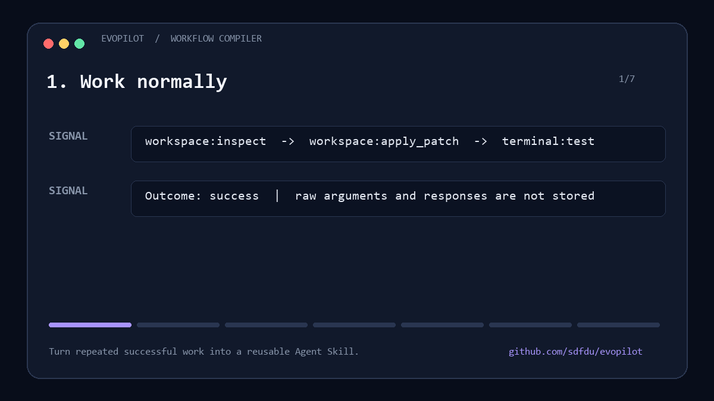
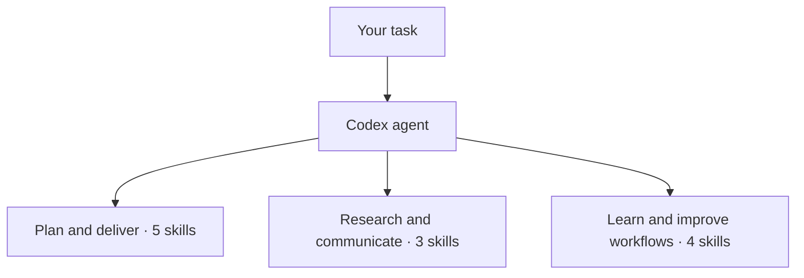
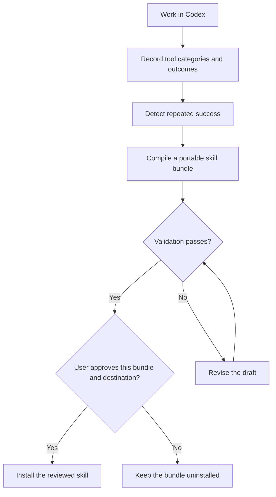

<div align="center">

# EvoPilot

**A local-first workflow compiler for Codex**

[](https://github.com/sdfdu/evopilot/actions/workflows/ci.yml)
[](https://github.com/sdfdu/evopilot/releases)
[](LICENSE)

[Install in Codex](#install-in-codex) · [Try the demo](#try-it-in-60-seconds) · [Browse skills](#one-codex-agent-multiple-skills) · [How it works](#how-it-works) · [Development](#development)

</div>

EvoPilot turns repeated successful work into portable [Open Agent Skills](https://agentskills.io/) and keeps frequently used workflow guidance available through token-capped policy cards.

It does not train model weights, store raw tool logs, or silently expand permissions. Every generated bundle includes its evidence, provenance, review state, and quality findings.

## Install in Codex

Install the published plugin with the Codex CLI.

```bash
codex plugin marketplace add sdfdu/evopilot
codex plugin add evopilot@evopilot
```

Restart Codex, start a new task, and ask:

```text
Run the EvoPilot 60-second workflow compiler demo.
```

To make EvoPilot the default workflow layer for future tasks, run this from the repository root. [Codex defaults setup](docs/codex-defaults.md)

```bash
./scripts/install-codex-defaults.sh
```

See [How to use EvoPilot](docs/how-to-use.md) for real-work commands, [Behavior Cloning Lite](docs/behavior-cloning-lite.md) for token-capped policy learning, and the Skill review flow.

## Try it in 60 seconds

The standalone demo requires Python 3.10 or later. Run these commands from a terminal.

```bash
git clone https://github.com/sdfdu/evopilot.git
cd evopilot
python3 plugins/evopilot/scripts/evopilot.py doctor
python3 plugins/evopilot/scripts/evopilot.py demo --destination ./evopilot-demo
python3 plugins/evopilot/scripts/evopilot.py validate-skill ./evopilot-demo/workspace-inspect-workspace-apply-patch-terminal
```

The deterministic demo is marked `demo_only` and never enters learned history. Inspect these files:

```text
evopilot-demo/workspace-inspect-workspace-apply-patch-terminal/
├── SKILL.md
├── evopilot.json
├── QUALITY_REPORT.md
└── WHAT_HAPPENED.md
```



## Compare workflow storage options

| Approach | Remembers facts | Captures a repeatable workflow | Evidence and quality gates | Portable and versionable |
|---|---:|---:|---:|---:|
| Chat history | Yes | No | No | No |
| Saved prompt | Sometimes | Manually | No | Sometimes |
| Agent memory | Yes | Sometimes | Usually no | Usually no |
| EvoPilot Skill | Yes | Yes | Yes | Yes |

## One Codex agent, multiple skills

EvoPilot is one Codex plugin. The active Codex agent can select several skills over the course of a task. Each bundled skill has its own `SKILL.md` with a description that helps Codex select it and instructions that guide the work.



### Plan and deliver

| Skill | Use it to | Example request |
| --- | --- | --- |
| [`idea-lab`](plugins/evopilot/skills/idea-lab/SKILL.md) | Shape a rough idea into a decision | Help me choose a direction for this idea before we build. |
| [`dev-flow`](plugins/evopilot/skills/dev-flow/SKILL.md) | Implement, debug, and verify software changes | Fix this bug and run the relevant tests. |
| [`tool-operator`](plugins/evopilot/skills/tool-operator/SKILL.md) | Coordinate files, terminals, browsers, and apps | Find the local report and verify which version is current. |
| [`automation-watcher`](plugins/evopilot/skills/automation-watcher/SKILL.md) | Plan reminders and recurring checks | Remind me every Friday to review open tasks. |
| [`project-handoff`](plugins/evopilot/skills/project-handoff/SKILL.md) | Prepare a project handoff | Write a handoff so someone can resume this project tomorrow. |

### Research and communicate

| Skill | Use it to | Example request |
| --- | --- | --- |
| [`research-synthesis`](plugins/evopilot/skills/research-synthesis/SKILL.md) | Compare findings across research sources | Compare these papers and summarize what I can cite in my thesis. |
| [`presentation-visual-design`](plugins/evopilot/skills/presentation-visual-design/SKILL.md) | Design, restyle, or visually review slides | Give this deck a consistent layout and improve chart readability. |
| [`application-tailor`](plugins/evopilot/skills/application-tailor/SKILL.md) | Tailor an internship or job application | Prepare my application for an AI and ERP internship. |

### Learn and improve workflows

| Skill | Use it to | Example request |
| --- | --- | --- |
| [`knowledge-coach`](plugins/evopilot/skills/knowledge-coach/SKILL.md) | Organize what you learned and identify recurring friction | Summarize what I learned and what I kept getting stuck on. |
| [`decision-capture`](plugins/evopilot/skills/decision-capture/SKILL.md) | Record confirmed decisions | Save why we chose option B. |
| [`extension-foundry`](plugins/evopilot/skills/extension-foundry/SKILL.md) | Turn proven workflows into reusable skills | Which repeated workflows are ready to become a skill? |
| [`skill-evaluator`](plugins/evopilot/skills/skill-evaluator/SKILL.md) | Check skill selection and behavior | Test what happens when I say to implement option B. |

Ask in your own words, or pick the skill explicitly in a client that supports skill mentions. For example, select `evopilot:dev-flow` when you want to apply its coding and verification workflow.

## How it works



1. Hooks record tool categories and outcomes, never raw arguments or responses.
2. Transparent thresholds identify repeated workflows instead of promoting one lucky run.
3. The compiler creates `SKILL.md`, provenance, evidence, and a human-readable quality report.
4. Structural and semantic gates block generic, repetitive, unsafe, or underspecified Skills.
5. Installation requires an exact one-time confirmation bound to the reviewed bundle and destination.

### Evidence thresholds

| Workflow state | Minimum observations | Minimum successes |
| :--- | ---: | ---: |
| Candidate | 3 | — |
| Draft ready | 5 | 3 |
| Stable | 8 | 3 |

## What ships today

| Component | What it provides |
| :--- | :--- |
| Local memory | SQLite-backed history, corrections, conflict tracking, and confidence decay |
| Codex hooks | Privacy-minimized observations and fail-closed action review |
| Workflow compiler | Sequence detection, portable skill bundles, evidence, and provenance |
| Quality checks | Structural validation, semantic assessment, and annotations for skill review |
| Behavior Cloning Lite | Episode fingerprints and promoted policy cards in token-capped runtime context |
| MCP and CLI | 18 runtime MCP tools, plus CLI maintenance, export, diagnostics, the deterministic demo, and weekly reports |

## Safety boundaries

| Action | Default |
|---|---|
| Read, search, analyze | Autonomous |
| Edit an authorized workspace | Autonomous |
| Run tests and builds | Autonomous |
| Compile an uninstalled Skill bundle | Autonomous |
| Delete material data | Human required |
| Send, publish, purchase, or make public | Human required |
| Use credentials or change system settings | Human required |
| Enable MCP or expand access | Human required |
| Unknown action | Fail closed |

EvoPilot complements Codex sandboxing, operating-system permissions, and service-side authorization; it does not replace them.

## Limits

- Workflow detection uses transparent sequence mining and policy-card behavior cloning, not model-weight training.
- Hooks observe Codex tool events, not every gesture inside arbitrary desktop applications.
- Validation checks the bundle; it does not prove every workflow succeeds in every environment.
- EvoPilot does not generate or enable credentialed MCP servers automatically.
- The deterministic policy gate cannot prove that every command is safe.

## Repository layout

| Path | Contents |
| --- | --- |
| [`plugins/evopilot/skills/`](plugins/evopilot/skills/) | Bundled skills, each defined in its own `SKILL.md` |
| [`plugins/evopilot/.codex-plugin/`](plugins/evopilot/.codex-plugin/) | Plugin manifest and Codex interface configuration |
| [`plugins/evopilot/hooks/`](plugins/evopilot/hooks/) | Codex event handling and safety checks |
| [`plugins/evopilot/mcp/`](plugins/evopilot/mcp/) | Runtime MCP server |
| [`plugins/evopilot/scripts/`](plugins/evopilot/scripts/) | CLI, storage, and workflow compiler |
| [`tests/`](tests/) | Automated checks for the core, hooks, and MCP server |

## Development

Run the test suite and plugin diagnostics from the repository root.

```bash
python3 -m unittest discover -s tests -v
python3 plugins/evopilot/scripts/evopilot.py doctor --plugin-root plugins/evopilot
```

To regenerate the demo animation, run `python3 tools/render_demo.py`.

## Further reading

- Using EvoPilot, inspecting generated bundles, and reviewing installation. [Usage guide](docs/how-to-use.md) · [Skill lifecycle](docs/skill-lifecycle.md) · [Quality gates](docs/quality-gates.md)
- Understanding promoted workflow policies and how the runtime loads them. [Behavior Cloning Lite](docs/behavior-cloning-lite.md)
- Data handling, issue reporting, and project participation. [Privacy](docs/privacy.md) · [Security](SECURITY.md) · [Support](SUPPORT.md) · [Contributing](CONTRIBUTING.md) · [Roadmap](ROADMAP.md)

## License

MIT License. See [LICENSE](LICENSE).
